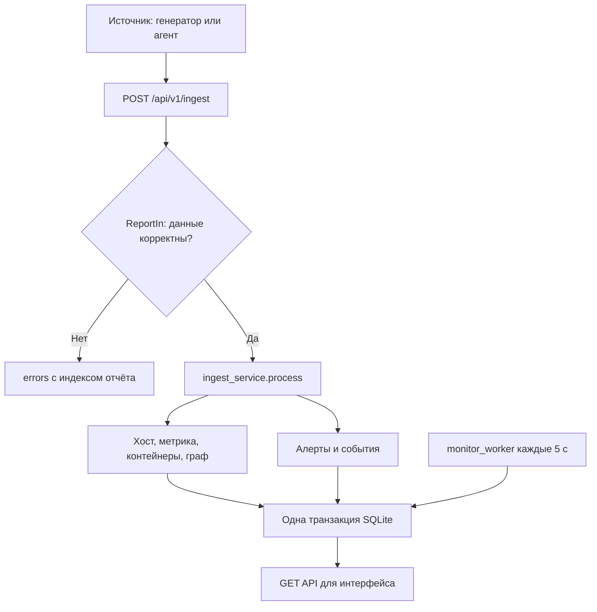
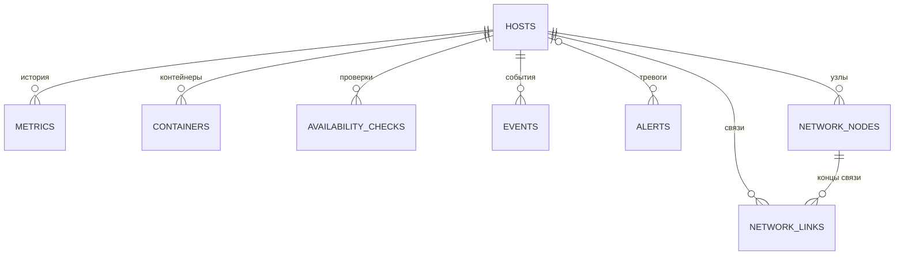

# Backend кейс 4: запуск, проверка и устройство

## 1. Что сейчас готово

Backend принимает отчёты, проверяет JSON, сохраняет данные в SQLite, определяет доступность, создаёт и закрывает алерты, отдаёт сведения для будущего интерфейса. Данные действительно записываются в базу: рабочие маршруты не используют app/stubs.py.

Frontend в main пока состоит из папок-заготовок. Поэтому сейчас результат смотрим в Swagger и JSON-ответах. Страницы с карточками и красивым графом ещё не появятся. Корневой адрес `/` может вернуть `{"detail":"Not Found"}` — это нормально, маршрута `/` нет.

Настоящий агент по плану делает команда кейса 1. Наша часть — приём данных и мониторинг; `mock-data/generator.py` только имитирует источник.

## 2. Что исправлено при проверке

| Проблема | Последствие | Исправление и файл |
| --- | --- | --- |
| Контейнер сохранял running в API, когда сервер уже недоступен | Сводка показывала работающие контейнеры, а граф — unknown | Единый расчёт `container_status` в `backend/app/services/dashboard_service.py`: используется списком, карточкой, графом и счётчиками |
| Контейнер перестал приходить, но хост продолжает работать | Старое состояние могло показываться бесконечно | Проверка возраста `Container.last_seen`; после WARNING_AFTER статус в выдаче unknown |
| dead давал алерт, но не попадал в число остановленных | Алерты и дашборд противоречили друг другу | dead добавлен в расчёт containers_stopped |
| timestamp мог быть на год вперёд | Следующие обычные отчёты считались устаревшими и игнорировались | Валидатор времени в `schemas/ingest.py`; допустимое опережение 60 с, настраивается |
| Сетевой счётчик больше диапазона SQLite INTEGER проходил валидацию | Вместо ошибки конкретного поля получалась ошибка сохранения БД | Верхняя граница 2^63−1 в `HostIn` |
| Не создавалось событие регистрации нового сервера | После первого нормального отчёта лента могла быть пустой | `source_registered` в `services/ingest_service.py`, в той же транзакции |
| Без .env использовались пороги 120/150 с и проверка раз в 30 с | Минутный отказ из демосценария мог вообще не стать offline | Значения по умолчанию согласованы с .env.example: 10/20/5 с |
| Тест очистки использовал дату из примера как свежую | Через 7 дней тест начинал падать без изменений кода | В тесте свежая метрика получает текущее время |

Регрессионные проверки находятся в `backend/tests/test_backend_regressions.py`. Шесть первоначальных проверок воспроизводили ошибки до исправления. Общий набор после исправлений: 62 успешных теста на Python 3.12. Проверены миграции с нуля и `alembic check`. Отдельный живой прогон Uvicorn с генератором: приняты 3 сервера и 11 контейнеров, зафиксированы warning и offline, открыты 3 алерта, после возвращения отчётов все 3 закрыты и снова видны 11 running-контейнеров. Windows здесь не запускалась: команды ниже предназначены для PowerShell, а фактический прогон выполнен в Linux.

## 3. Запуск на Windows в VS Code

### 3.1. Получить исправления

Пока pull request не объединён, обычный `git pull` в main не принесёт исправления. Для отдельной проверки ветки:

```powershell
git clone https://github.com/vanitas-sss/case4.git case4-backend-check
cd case4-backend-check
git fetch origin
git switch --track origin/fix/backend-review-2026-11-13
code .
```

Эти команды создают отдельную папку, поэтому незакоммиченные изменения в старой рабочей копии не затрагиваются. После объединения PR можно работать с обновлённой main.

Нужны Python 3.11 или 3.12 и Git. В терминале VS Code проверь:

```powershell
py --list
git --version
```

### 3.2. Создать окружение и поставить зависимости

Из корня репозитория:

```powershell
py -3.12 -m venv .venv
.\.venv\Scripts\python.exe -m pip install -r backend\requirements.txt
.\.venv\Scripts\python.exe -m pip install -r mock-data\requirements.txt
cd backend
Copy-Item .env.example .env
..\.venv\Scripts\python.exe -m alembic upgrade head
..\.venv\Scripts\python.exe -m uvicorn app.main:app --reload
```

Если установлен только Python 3.11, замени первую команду на `py -3.11 -m venv .venv`. Остальные команды такие же. Активация окружения не нужна: явно запускается Python из `.venv`, поэтому PowerShell ExecutionPolicy не мешает.

`Copy-Item` нужен при первом запуске, когда своего `.env` ещё нет. Если файл уже есть, открой его и проверь настройки вручную, не затирай свои значения:

```dotenv
DB_PATH=data/metrics.db
HEARTBEAT_INTERVAL=5
WARNING_AFTER=10
OFFLINE_AFTER=20
ALERT_AFTER_OFFLINE=10
CHECK_PERIOD=5
RETENTION_DAYS=7
MAX_FUTURE_SKEW_SECONDS=60
```

Терминал с Uvicorn оставь открытым. Должен появиться адрес `http://127.0.0.1:8000` и завершиться запуск приложения без traceback. При первом старте Alembic создаёт таблицы; повторный запуск сохраняет данные.

Открой:

- http://127.0.0.1:8000/api/v1/health — `{"status":"ok"}`.
- http://127.0.0.1:8000/docs — Swagger, список адресов API.
- http://127.0.0.1:8000/api/v1/hosts — на новой базе `[]`.

Health подтверждает, что HTTP-приложение отвечает. Это не отдельная проверка состояния диска, источников или всех таблиц.

### 3.3. Запустить источник

Открой второй терминал в корне репозитория:

```powershell
.\.venv\Scripts\python.exe mock-data\generator.py --url http://127.0.0.1:8000/api/v1/ingest --interval 5
```

Ожидается HTTP 200, `accepted: 3`, `rejected: 0` каждые 5 секунд. В текущих JSON-файлах заданы 3 сервера и 11 контейнеров: 4 + 4 + 3. Это точное количество для чистой базы и обычного state.json. Если раньше импортировались другие источники, суммарное количество будет больше.

| Адрес | Что увидеть при работающей заглушке |
| --- | --- |
| `/api/v1/hosts` | server-01, server-02, server-03, status online, CPU/RAM/Disk, last_seen |
| `/api/v1/summary` | hosts_total 3, hosts_online 3, containers_total 11, containers_running 11 |
| `/api/v1/containers` | Массив контейнеров с host_id, docker_id, image, ip, networks, status |
| `/api/v1/topology` | Объект с nodes, links, generated_at; это данные графа, а не картинка |
| `/api/v1/events?type=source_registered` | По событию регистрации для нового сервера |
| `/api/v1/alerts?status=active` | Обычно пустой массив, пока нет проблемы |
| `/api/v1/availability?period=24h` | Статус, last_seen, checks_total, uptime_percent |

В Swagger нажми нужный GET → Try it out → Execute. Смотри Response body и код 200. Для карточки и метрик бери id из `/hosts`, не предполагай, что у нужного сервера всегда id=1.

### 3.4. История для графика

На новой базе сначала заполни историю, затем запускай непрерывный генератор:

```powershell
.\.venv\Scripts\python.exe mock-data\seed.py --minutes 60
```

Команда выполняется из корня отдельным терминалом при работающем backend. Она отправляет исторические точки. Затем `/api/v1/hosts/{id}/metrics?period=1h` должен вернуть массив метрик. Backend отдаёт не больше 500 выбранных точек, сохраняя начало и конец диапазона.

Важно: более старые отчёты для уже существующего хоста сейчас игнорируются. Поэтому запуск seed после живого генератора не заполнит прошлый час. Для отдельного чистого демо можно остановить backend, указать в `.env` новый путь `DB_PATH=data/demo-review.db`, запустить снова, выполнить seed, затем генератор. Старую базу удалять не нужно.

## 4. Проверка вручную

### 4.1. Отказ сервера и восстановление

При обычном запуске генератора открой `mock-data/state.json`. Для отказа только второго сервера сохрани:

```json
{
  "servers": {"server-02": "offline"},
  "containers": {},
  "cpu_override": {}
}
```

Генератор перечитывает файл и перестаёт отправлять server-02. Остальные два продолжают приходить. Отсчёт идёт от последнего принятого отчёта, а не точно от нажатия Ctrl+S.

| Время без отчёта | Ожидаемый результат |
| --- | --- |
| Менее 10 с | online |
| От 10 с | warning |
| От 20 с | offline |
| От 30 с | Один active-алерт host_offline, severity critical |
| Ещё 30–60 с | Тот же алерт, без новых дублей при обычном одном процессе |
| После возвращения данных | online, алерт resolved, заполнен resolved_at |

Фоновый цикл идёт раз в 5 с, поэтому событие и алерт могут появиться с дополнительной задержкой до одного цикла и времени обработки. GET вычисляет актуальный статус по времени даже между циклами; поэтому цвет/статус может измениться чуть раньше записи события.

Контейнеры неработающего источника возвращаются как unknown и не входят в containers_running или containers_stopped. Unknown означает «нет свежего подтверждения», а не «точно остановлен».

Верни `"servers": {}`. Через следующую отправку, обычно до 5 с, сервер восстановится. Проверь `/alerts?status=resolved` и `/events`.

Можно вместо state.json остановить весь генератор Ctrl+C: тогда по очереди устареют все три сервера. Backend при этом оставь работающим.

### 4.2. Остановка контейнера

```json
{
  "servers": {},
  "containers": {"backend": "stopped"},
  "cpu_override": {}
}
```

После следующего отчёта контейнер backend на server-01 получает stopped, а `/alerts?status=active` — container_stopped. Сейчас алерт создаётся сразу после такого отчёта: задержка 10 с из плана ещё не реализована. Повторные отчёты не создают новые активные алерты при последовательной обработке. Верни `"containers": {}`: на running алерт закроется.

### 4.3. Высокий CPU

Поставь `"cpu_override": {"server-03": 95}`. Генератор плавно поднимает значение, а не скачком выставляет ровно 95. Когда фактическое cpu_percent достигнет 90, появится cpu_high. После возврата ниже 90 алерт закроется. Текущее правило мгновенное; требование «выше 90% непрерывно 120 с» из опциональной части плана пока не реализовано.

### 4.4. Проверить приём и ошибки через Swagger

В POST `/api/v1/ingest` → Try it out вставь массив:

```json
[
  {
    "source_id": "manual-test",
    "timestamp": "2026-11-13T12:00:00Z",
    "host": {"name": "test-server", "status": "online", "cpu_percent": 42},
    "containers": []
  }
]
```

Перед каждой новой отправкой обновляй timestamp на текущее UTC. Его можно получить в PowerShell:

```powershell
(Get-Date).ToUniversalTime().ToString("yyyy-MM-ddTHH:mm:ss.fffZ")
```

Ожидается accepted=1 и rejected=0. Затем сервер появится в `/hosts`. Без новых отчётов он закономерно станет offline.

| Проверка | Результат |
| --- | --- |
| cpu_percent=150 | HTTP 200, accepted=0, rejected=1, в errors указано поле host.cpu_percent |
| Удалить host.name | Отчёт отклонён, ошибка указывает host.name |
| timestamp на год вперёд | Отчёт отклонён с ошибкой timestamp |
| net_rx_bytes=9223372036854775808 | Ошибка поля, а не внутренняя ошибка SQLite |
| Убрать внешние квадратные скобки | HTTP 422: API принимает массив, а не один объект |
| Массив из одного правильного и одного неправильного объекта | accepted=1, rejected=1, индекс ошибки начинается с 0 |
| Повторить тот же timestamp того же хоста | accepted=1, но новая метрика не создаётся; accepted означает обработанный без ошибки отчёт |

Неправильный тип элемента массива, например число вместо объекта, отклоняется FastAPI до поэлементной обработки: весь запрос получает 422. Частичное принятие работает для массива объектов с ошибками в полях.

POST `/api/v1/import` принимает файл с этим же массивом отчётов, UTF-8 или UTF-8 BOM, до 2 МиБ. Неправильный JSON → 400, неправильная структура → 422, слишком большой файл → 413. Произвольный отчёт кейса 1 автоматически не преобразуется.

### 4.5. Автоматические тесты

Из корня репозитория:

```powershell
cd backend
..\.venv\Scripts\python.exe -m pytest -q
..\.venv\Scripts\python.exe -m alembic check
```

После этого PR ожидается `62 passed`; alembic check — `No new upgrade operations detected.` Тесты используют временные базы, не должны менять рабочую SQLite. В среде проверки остались два предупреждения зависимостей о будущих изменениях тестового API; это не падения тестов.

При необходимости проверить оформление кода из корня:

```powershell
.\.venv\Scripts\python.exe -m pip install ruff
.\.venv\Scripts\python.exe -m ruff check backend mock-data
```

## 5. Как проходит один отчёт



1. `app/main.py` создаёт FastAPI. При старте `lifespan` вызывает `init_db()`, затем запускает задачи мониторинга и очистки.
2. `api/v1/router.py` собирает маршруты. Префикс `/api/v1` добавляется в main.py один раз.
3. `api/v1/ingest.py:ingest` получает список словарей. Для каждого отдельно вызывает `ReportIn.model_validate`.
4. `schemas/ingest.py` проверяет обязательные поля, диапазоны, уникальность контейнеров/узлов/связей, наличие концов связей и время отчёта.
5. `services/ingest_service.py:process` находит хост по source_id + name и сравнивает timestamp с последней метрикой. Повторы и старые отчёты не перезаписывают актуальное состояние.
6. `IngestReport` хранит уникальный ключ отчёта. Это дополнительная защита от одинаковой повторной отправки.
7. Репозитории создают или обновляют хост, добавляют метрику, обновляют контейнеры и снимок топологии. Сервисы алертов записывают изменения тревог.
8. `db.commit()` сохраняет весь отчёт. При исключении `db.rollback()` откатывает его целиком. Остальные объекты массива могут обрабатываться дальше.
9. GET-маршруты вызывают `dashboard_service`, который собирает JSON из БД и вычисляет текущие статусы.

`flush()` отправляет изменения в базу внутри транзакции: например, чтобы получить host.id. Это ещё не окончательное сохранение. `commit()` завершает транзакцию; после rollback незавершённые изменения пропадают.

Пример из `ingest_service.py`:

```python
host = hosts_repo.upsert_host(
    db=db,
    source_id=source_id,
    name=host_data["name"],
    ip=host_data.get("ip"),
    status=host_status,
    last_seen=received_at,
)
```

`upsert` означает «обнови существующий объект, а если его нет — создай». Здесь не используется IP как уникальный ключ: IP может меняться. Два разных источника могут иметь серверы с одинаковым именем.

## 6. Карта всех частей backend

Пути в таблице относительно `backend/`.

| Файл или группа | За что отвечает |
| --- | --- |
| `app/main.py` | FastAPI, CORS, запуск и остановка фоновых задач, подключение роутера |
| `app/core/config.py` | Настройки `.env`, значения по умолчанию, проверка разумности порогов |
| `app/core/time.py` | UTC и преобразование aware-datetime в UTC без timezone для SQLite |
| `app/db/base.py` | Общая SQLAlchemy Base для моделей |
| `app/db/session.py` | Путь БД, engine, SessionLocal, сессия запроса get_db, WAL, foreign_keys, busy_timeout |
| `app/db/init_db.py` | Применение миграций Alembic при старте |
| `app/models/host.py` | Сервер и его связи с историей/контейнерами |
| `app/models/container.py` | Последнее известное состояние контейнера |
| `app/models/metric.py` | История CPU/RAM/Disk и сетевых счётчиков, ограничения диапазонов |
| `app/models/network.py` | Узлы и связи, их уникальность и внешние ключи |
| `app/models/availability.py` | Периодические результаты проверки доступности |
| `app/models/event.py` | Лента событий |
| `app/models/alert.py` | Алерты и таблица AlertRule; динамические правила из таблицы пока не исполняются |
| `app/models/ingest_report.py` | Уникальные ключи уже принятых отчётов |
| `app/schemas/ingest.py` | Входные Pydantic-модели и валидаторы JSON |
| `app/repositories/hosts_repo.py` | Найти/создать/обновить хост |
| `app/repositories/containers_repo.py` | Найти/обновить контейнер, сохранить networks |
| `app/repositories/metrics_repo.py` | Добавить метрику, получить историю и последнюю точку |
| `app/repositories/network_repo.py` | Полностью заменить снимок графа одного хоста |
| `app/repositories/availability_repo.py` | Записать проверку доступности и прочитать проверки |
| `app/repositories/events_repo.py` | Добавить и прочитать события |
| `app/repositories/alerts_repo.py` | CRUD-помощники алертов и правил; основной alert_service также делает запросы напрямую |
| `app/services/ingest_service.py` | Обработка одного отчёта и границы транзакции |
| `app/services/alert_service.py` | Текущие условия host_offline, cpu_high, container_stopped, закрытие тревог |
| `app/services/dashboard_service.py` | Выдача хостов, контейнеров, метрик, графа, доступности, событий, алертов, сводки |
| `app/services/case1_adapter.py` | Отдельная заготовка конвертера предположительного формата кейса 1; не вызывается маршрутом import |
| `app/workers/monitor.py` | Проверка времени последнего отчёта и heartbeat-алертов; оболочки фоновых задач |
| `app/workers/cleanup.py` | Удаление старой истории, без собственного commit |
| `app/api/v1/*.py` | HTTP-маршруты, параметры запросов, ответы и HTTP-ошибки |
| `app/stubs.py` | Старые статические примеры, не источник данных рабочих GET-эндпоинтов |
| `migrations/versions/*.py` | Последовательные изменения схемы БД |
| `migrations/env.py`, `alembic.ini` | Настройка запуска миграций |
| `tests/test_database.py` | Транзакции, ограничения, обновление, повторные отчёты, очистка и часть алертов |
| `tests/test_ingest.py` | HTTP-приём и структура ответов API |
| `tests/test_monitoring_completion.py` | Heartbeat, импорт, CORS, контейнерные алерты |
| `tests/test_time.py` | Нормализация UTC |
| `tests/test_backend_regressions.py` | Проверки ошибок, исправленных в этом PR |
| `examples/ingest.example.json` | Пример входного массива |
| `requirements.txt`, `pytest.ini` | Зависимости и настройки pytest |

Фактическая структура немного отличается от плана: отдельные `availability_service.py`, `summary_service.py`, `topology_service.py` не созданы, их функции находятся в `dashboard_service.py` и `workers/monitor.py`. Запросы SQLAlchemy есть не только в repositories, но и в services. Это не идеальное разделение, однако для небольшого прототипа путь данных остаётся понятным. При росте проекта запросы стоит постепенно выносить в репозитории.

## 7. Что лежит в базе



- `hosts` — по одной записи на source_id + name. `last_seen` — когда backend принял свежий отчёт.
- `metrics` — много точек на один хост. `timestamp` — время измерения у источника. Это другое время, не last_seen.
- `containers` — уникальность host_id + docker_id; последнее сохранённое состояние, не история каждого состояния.
- `network_nodes`, `network_links` — последний переданный граф. Внешние ключи не дают сохранить связь без узла.
- `availability_checks` — результаты периодических проверок для расчёта процента доступности.
- `events` — что произошло и когда; `alerts` — проблема с жизненным циклом active → resolved.
- `ingest_reports` — ключи source_id + host_name + timestamp для повторных запросов; внешнего ключа на hosts нет.
- `alert_rules` — таблица есть, но действующая логика использует условия в Python, не произвольные правила из таблицы.

Индекс `(host_id, timestamp)` помогает искать историю конкретного сервера. Уникальные ограничения предотвращают дубли объектов. Внешние ключи защищают целостность. WAL позволяет читателям работать во время записи, но не превращает SQLite в базу с множеством одновременных писателей.

Почему нужна транзакция: если успели записать хост и метрику, но граф не сохранился, без rollback база содержала бы половину отчёта. Сейчас при ошибке весь этот отчёт откатывается.

## 8. Статусы, алерты и фоновые задачи

`monitor_worker` вызывает синхронную проверку через `asyncio.to_thread`, затем ждёт CHECK_PERIOD. Работа с SQLite не выполняется прямо в event loop FastAPI. Для каждого прохода создаётся отдельная сессия.

Возраст хоста = текущее серверное UTC − last_seen. При 10 с хост становится warning, при 20 с offline. При 30 с без отчёта открывается heartbeat-алерт host_offline. При новом отчёте с online он закрывается. Явный статус из отчёта также учитывается: если источник сам сообщает offline, текущий alert_service открывает тревогу сразу.

Контейнерный статус вычисляется перед выдачей. Если хост не online или нет свежих данных о контейнере, возвращается unknown. Само последнее известное состояние в базе не затирается: при восстановлении источник пришлёт актуальное состояние. Это лучше, чем объявлять stopped без доказательства остановки.

Условия текущих алертов:

| Правило | Открывается | Закрывается |
| --- | --- | --- |
| host_offline | Таймаут OFFLINE_AFTER + ALERT_AFTER_OFFLINE либо явный offline из источника | При обработке отчёта, когда условие offline больше не выполняется |
| cpu_high | Новая метрика CPU >=90 | Новая метрика CPU <90; отсутствие CPU само по себе не закрывает алерт |
| container_stopped | stopped/exited/dead при хосте online | Новый running при хосте online |

В events записываются source_registered, host_status_changed, container_status_changed, alert_opened, alert_resolved. Это фактические имена; часть примеров в старом плане использует host_online/host_offline и container_started/container_stopped. Фронтенду нужно ориентироваться на действующий API, а не смешивать оба набора.

`cleanup_worker` раз в час вызывает `cleanup_old_records`. Сейчас metrics, events, availability_checks и ключи ingest_reports удаляются старше RETENTION_DAYS, по умолчанию 7 дней. Хосты, контейнеры, топология и алерты не удаляются этой функцией. В плане для events указано 30 дней — отдельный срок событий пока не реализован.

`uptime_percent` = число успешных проверок / число всех проверок × 100. Например, 18 online-проверок из 20 → 90%. Это доля наблюдений, а не точный SLA за каждую секунду: время, когда сам backend был выключен, не превращается автоматически в потерянные проверки.

## 9. Какие задачи решает архитектура и почему выбраны эти решения

| Задача | Решение | Почему подходит сейчас | Другой вариант и его цена |
| --- | --- | --- | --- |
| Команды присылают разные данные | Общий JSON-контракт + Pydantic | Ошибки обнаруживаются на входе, понятно имя поля | Ручные if-проверки проще начать, но легко пропустить вложенные ограничения |
| Нужно быстро показать API без фронтенда | FastAPI и Swagger | Можно вручную отправить запрос и увидеть ответ | Flask тоже подходит, но схемы и документацию пришлось бы настраивать отдельно |
| Источник может быть ещё не готов | Отдельный генератор с тем же контрактом | Проверяется весь путь до БД, потом источник заменяется | Моки внутри GET не проверяли бы реальное сохранение |
| Отчёты могут повторяться | timestamp + уникальные ключи + проверка порядка | Повторная доставка не плодит метрики и события | Отдельный UUID каждого отчёта лучше разделяет время и идентичность, но требует изменения контракта |
| Источник перестал отвечать | Серверное last_seen и фоновая проверка | Не нужен доступ backend к каждому серверу | Ping/pull требует адресов, доступа и собственной логики опроса; ping не доказывает здоровье приложения |
| Одиночная задержка не должна сразу означать аварию | Переход online → warning → offline → alert | Есть время на очередную отправку и короткий сетевой сбой | Мгновенный offline даёт больше ложных тревог |
| Нельзя терять часть отчёта | Транзакция на один отчёт | Либо всё сохранено, либо ничего; ошибка одного хоста не отменяет весь пакет | Одна транзакция на весь массив проще атомарно, но плохой отчёт заблокирует остальных |
| Нужно запуститься без отдельного сервера БД | SQLite + WAL | Одна база-файл, легко проверить на ноутбуке | PostgreSQL лучше для большой параллельной нагрузки, но нужен отдельный сервис |
| На графе одинаковые имена у разных серверов | В общем графе id вида host_id:external_id | Узлы разных хостов не склеиваются | Глобальные UUID тоже подходят, но источник должен выдавать согласованные идентификаторы |
| Данные контейнера устарели | Вычисляемый unknown во всех GET | Нет ложного зелёного статуса; база хранит последний факт | Перезапись в stopped создаёт ложное утверждение об остановке |
| Часы источника ошибочны | Лимит будущего времени | Один плохой отчёт не блокирует обновления на месяцы | Порядковый номер отчёта или boot_id устойчивее к скачкам часов, но сложнее контракт |
| База должна обновляться у всей команды | Alembic | Изменения схемы повторяемы, не надо удалять БД | create_all создаёт таблицы, но не обновляет корректно существующую схему |
| Нужно ограничить рост истории | Периодическая очистка | Старые точки не копятся бесконечно | Архивирование/партиции полезны позже, сейчас добавят сложность |

Это выбор для учебного прототипа, а не доказательство, что стек лучше во всех проектах. Проверка 1000 источников и гарантия производительности не выполнялись. В выдаче хостов есть несколько запросов на каждый хост; история сначала загружается целиком, потом сокращается до 500 точек. Для большой нагрузки понадобятся пакетные запросы, агрегация в SQL, пагинация и измерения.

## 10. Что ещё отличается от плана

1. Нет фронтенда и полного Docker Compose. Backend сейчас запускается Python-командами выше. Dockerfile есть у заглушки, но это не готовый запуск всего проекта.
2. Нет задержки 10 с для остановленного контейнера; CPU-алерт мгновенный, без окна 120 с. Название правила — cpu_high. Эти различия не следует выдавать за выполненные требования плана.
3. Нет подключённого и проверенного адаптера реального формата кейса 1: нужен настоящий пример их JSON. `/import` поддерживает наш контракт.
4. PlantUML, Telegram и pull-опрос не реализованы. В плане это необязательные функции.
5. Отсутствующий в новом отчёте контейнер не удаляется и не получает unknown в БД немедленно; выдача считает его unknown после WARNING_AFTER без обновления. Это сохраняет совместимость с текущими частичными отчётами, но отличается от правила полного снимка в плане.
6. В events используются общие имена смены статуса; срок хранения событий 7 дней, не 30.
7. Сохранение одного и того же активного алерта защищено проверкой существования, но нет уникального ограничения активного алерта в БД. Одновременные конкурентные записи/несколько Uvicorn workers требуют дополнительной защиты и теста. Для текущего запуска используй один worker; `--reload` предназначен для разработки.
8. Нет авторизации и токенов — это исключено из текущего плана. Такая конфигурация предназначена для доверенного учебного окружения; локальный запуск привязан к 127.0.0.1.
9. `accepted` считает также повторы и проигнорированные устаревшие отчёты. Для загрузки запоздалой истории без изменения текущего состояния нужен отдельный режим backfill.
10. Отсутствующие значения cpu_percent не закрывают cpu_high; контейнерный алерт ждёт running, а не закрывается при исчезновении контейнера. Это нужно учитывать при демонстрации unknown.

## 11. Если что-то не запускается

| Симптом | Что проверить |
| --- | --- |
| No suitable Python runtime found | `py --list`; используй установленный 3.11 или 3.12 |
| No module named uvicorn/requests | Зависимости установлены именно через `.venv\Scripts\python.exe`; для requests нужен mock-data/requirements.txt |
| Could not import module app.main | Терминал backend должен находиться в папке backend |
| Input should be a valid list | Снаружи JSON должны быть квадратные скобки; путь `/api/v1/ingest` |
| accepted=0 | Смотри errors, а не только HTTP 200; проверь обязательные поля и timestamp |
| Серверы не становятся offline за 20 с | Старый .env или переменные окружения переопределяют пороги; после изменения перезапусти backend |
| В /hosts больше трёх серверов | В базе сохранены старые ручные тесты/импорты; для чистого демо выбери новый DB_PATH |
| График пустой после старого примера | timestamp примера вне выбранного периода; отправь текущую дату или seed до генератора |
| Порт занят | Останови прежний Uvicorn или запусти `--port 8001` и поменяй URL генератора |
| В браузере JSON вместо страницы | Пока готов API. Пользовательский интерфейс появится после реализации frontend |
| database is locked | Проверь, нет ли нескольких процессов записи, зависшего просмотрщика БД с транзакцией; запускай один backend worker |

Остановка: Ctrl+C в терминале генератора, затем Ctrl+C в терминале backend. SQLite-файл остаётся на диске, следующий запуск продолжает работу с ним.
